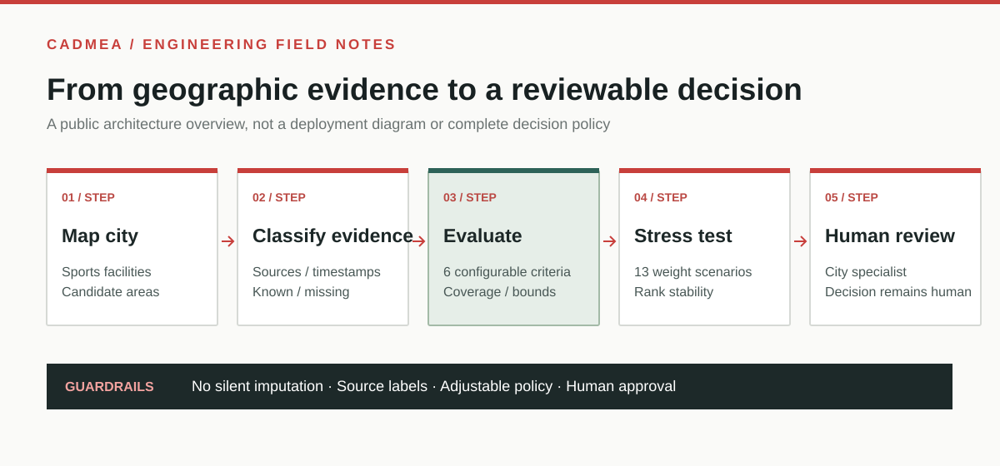
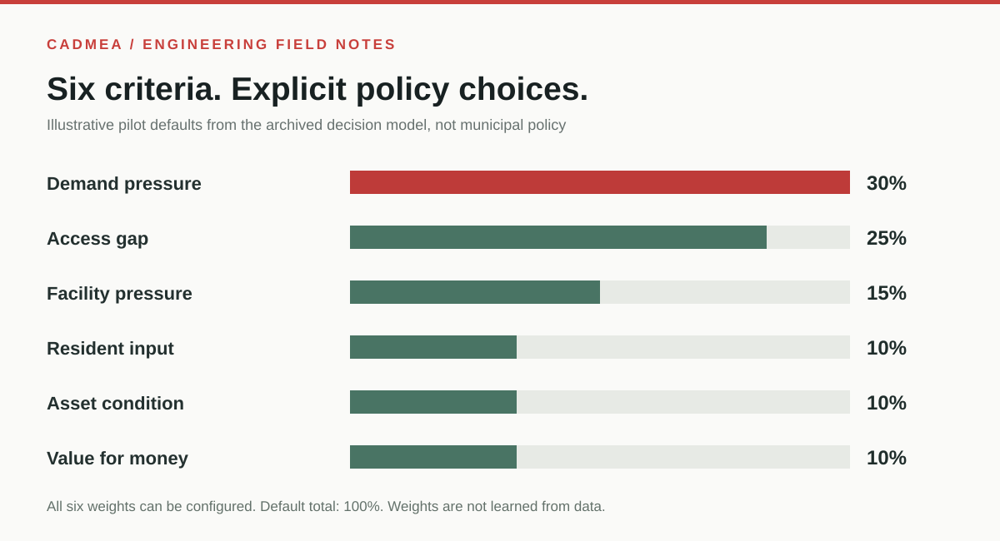
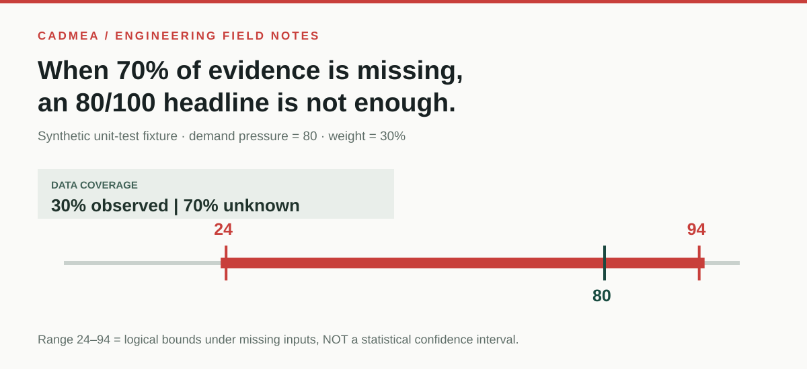

# CADMEA

### Turning a map of facilities into a question about public investment.

**Team-built municipal infrastructure intelligence prototype | Make It Real, Vilnius, May 2026**

**My role: CEO, team leadership, backend development and decision algorithm work.**

[Explore CADMEA](https://cadmeamap.com/) · [Development history](docs/BUILD_HISTORY.md) · [Engineering case study](docs/ENGINEERING.md) · [Contribution & evidence notes](docs/CONTRIBUTIONS_AND_EVIDENCE.md)

---

## The problem I wanted to solve

A city can know **where sports facilities are** without knowing where additional investment would be most defensible. Demand is uneven, citizen feedback is incomplete, and decisions about new sports facilities compete for limited resources. A map is useful, but showing locations alone does not justify a spending decision.

We built CADMEA as a way to bring **geographic infrastructure data, community signals, and explicit decision criteria** into one reviewable municipal workflow. It began as a team project for the international **Make It Real** hackathon in Vilnius, where our team won the **Active Vilnius challenge** and received recognition in the **FIRSTPICK investor category**.

Our larger goal is to help decision makers ask: *Which area needs attention, what supports that conclusion, and what evidence is still missing?*

## What I worked on

I led the project as CEO and contributed substantially to the backend and algorithms, working alongside teammates who handled additional backend work, frontend, quality assurance and marketing.

My technical focus included helping turn geographic and community information into structured, reviewable decision inputs; implementing and improving backend logic; and developing a scoring workflow where uncertainty is visible rather than hidden. I also worked on product strategy and the proposed municipality pilot.

**I was not the sole developer.** This is a collaborative project; the specific team responsibilities are documented [here](docs/CONTRIBUTIONS_AND_EVIDENCE.md). AI-assisted development was used as a tool, and I am not claiming to have trained a proprietary machine-learning model.

## What actually works

| Evidence | What it demonstrates |
| :--- | :--- |
| **A multi-page geographic application** | Sports facilities, planned projects, geographic layers, demand indicators, and municipal decision views |
| **Six-criterion decision model** | Explicit configurable policies rather than an unexplained “AI score” |
| **Missing-data safeguards** | Unknown access, cost or occupancy inputs remain unknown instead of being silently filled in |
| **13 sensitivity scenarios** | How relative ranks change when each criterion weight is varied |
| **Source and review labels** | Distinguishes documented, community and proxy inputs, and always requires human review |
| **12/12 tests passing** | Decision-model unit tests rerun from the recovered project archive on November 2, 2026 |

**Not claimed:** validated travel-time accessibility calculations, real-world forecast accuracy, official municipal approval of model weights, or deployed city budget automation.

## A closer look at the algorithm

Six adjustable weights are used for **demand pressure (30%)**, **access gap (25%)**, **facility pressure (15%)**, **resident input (10%)**, **asset condition (10%)** and **value for money (10%)**. These are *illustrative pilot defaults*, not independently optimized or officially approved policy.

**The uncomfortable example:** a candidate with only 30% of the weighted inputs available can have a conditional index of 80/100, yet its mathematically possible full weighted range is **24–94**. That result is not a prediction. It shows why a visually appealing number can be misleading without data-coverage context. [See the actual test and interpretation](docs/ENGINEERING.md).

## How the product evolved

1. **May 2026:** Built and demonstrated the original collaborative sports infrastructure prototype during Make It Real.
2. **Following the hackathon:** Developed the broader municipal infrastructure workspace and explored pilot conversations with Vilnius stakeholders.
3. **October 2026:** Reworked the decision logic to show provenance, preserve missing data, prevent inappropriate community-signal duplication and test weight sensitivity.
4. **October 2026:** Added/strengthened map-data ingestion resilience, a snapshot-based fallback and a restricted one-click viewer demo for review.
5. **November 2026:** Prepared a source-grounded portfolio with an independently rerun 12-test decision-model check and archived demo footage.

This is a **retrospective** timeline based on prior artifacts and project history, **not a claim that this new public repository contains all historical commits**.

[Read the full build history](docs/BUILD_HISTORY.md).

## Genuine product evidence

The original demo recording is a 23.8-second capture of the working UI, including the Vilnius map, demand views and OSM mini-infrastructure layer. [Open the product website](https://cadmeamap.com/).

The recording and original screenshots are intentionally distributed separately from this public documentation until the team's publication rights for media are confirmed. **No source code, authentication details or private partner datasets are published here.**

For context, the Oct 2026 OpenStreetMap mini-infrastructure snapshot contained **2,036 objects** comprising recycling sites, waste baskets and waste-disposal points. These **are not 2,036 sports facilities**.

## What this project taught me

**Scoring is easy. Defensible scoring is hard.** Early iterations could fill gaps with assumptions and produce clean rankings. We replaced those shortcuts with explicit missing values, source provenance, transparent policy weights and sensitivity analyses. Instead of presenting every candidate as a confident answer, the system can tell a municipal reviewer what is still needed before a decision.

A useful engineering system should be able to say *“we do not know yet.”*

---

*CADMEA was built by a team. This public portfolio documents product history, my contributions, and independently checkable technical behavior without releasing jointly owned source. The model remains a pilot screening tool, not an approved municipal investment policy.*
