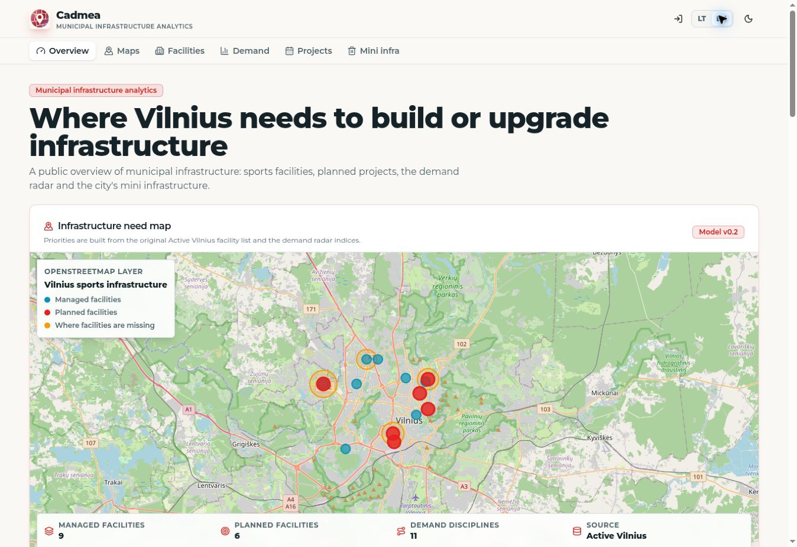
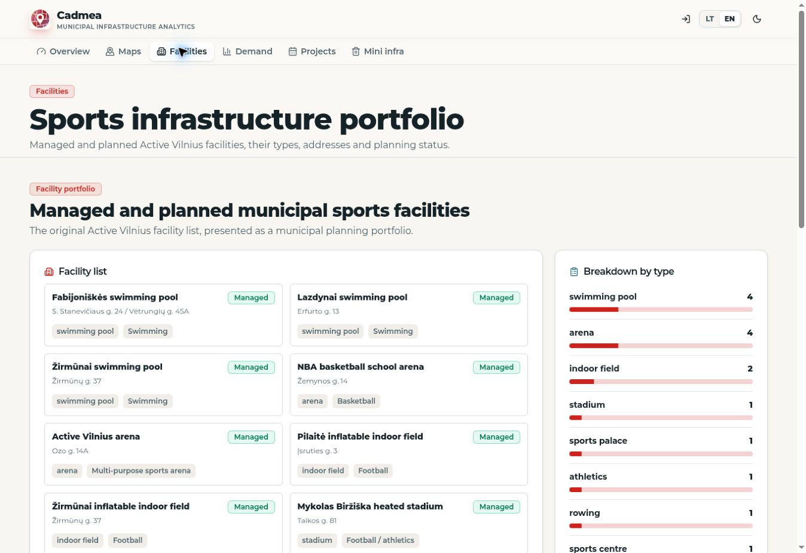
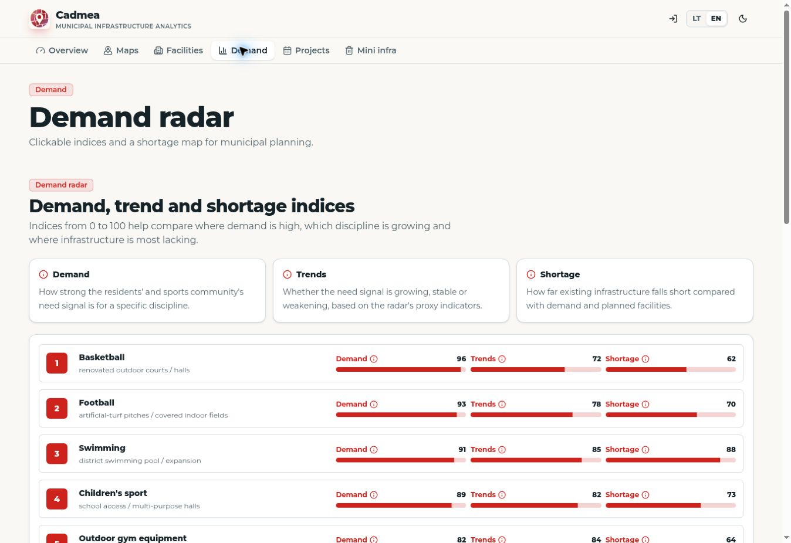
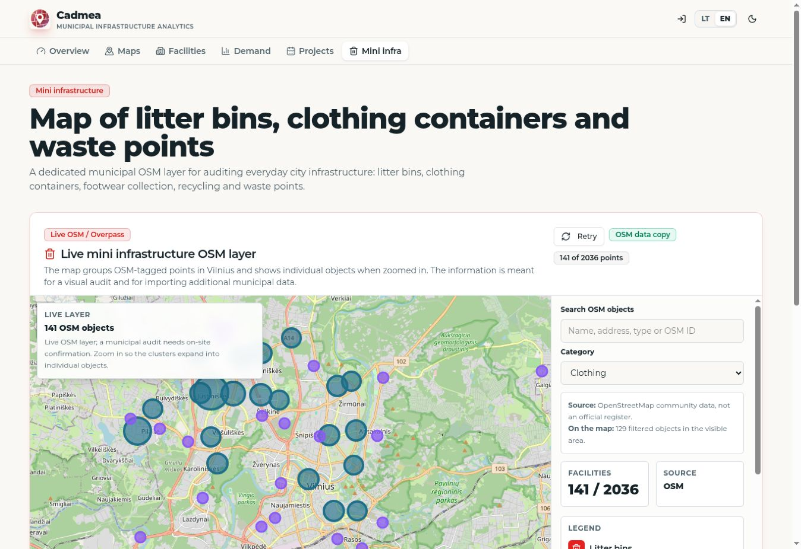

# CADMEA

**Help a city compare where to build, repair or investigate sports infrastructure.**

CADMEA brings facility locations, community signals and explicit decision criteria into a municipal planning workspace. Our team started it at Make It Real in Vilnius in May 2026, winning the Active Vilnius challenge and receiving recognition in the FIRSTPICK investor category.

**Paulius Pukinskas · Team lead / CEO · Backend and algorithms lead**

[Explore the application](https://cadmeamap.com/) · [My technical contributions](docs/MY_BACKEND_AND_ALGORITHM_WORK.md) · [Engineering case study](docs/ENGINEERING.md) · [Team credits](docs/CONTRIBUTIONS_AND_EVIDENCE.md)

[](https://cadmeamap.com/)

*The working public application, captured in English on November 7, 2026. The interface was built by the team; my technical focus was the backend and decision algorithms.*

## My technical contribution

I led product direction and worked hands on in the backend with another backend contributor. My focus was turning incomplete geographic and community information into a decision process a person could inspect.

| Problem | My contribution | Technical evidence |
| :--- | :--- | :--- |
| A map alone cannot justify an investment | Backend decision and ranking logic with six configurable criteria | [Decision model walkthrough](docs/MY_BACKEND_AND_ALGORITHM_WORK.md) |
| Missing observations can make a score misleading | Distinguish unknown from zero; report weighted coverage and possible score bounds | [Worked calculation](docs/ENGINEERING.md#the-decision-calculation) |
| Repeated or unrelated requests can inflate demand | District and sport matching, terminology normalization and duplicate signal handling | [Resident evidence logic](docs/MY_BACKEND_AND_ALGORITHM_WORK.md#concrete-example-2-community-signals-must-relate-to-the-proposed-facility) |
| Policy weights can change the shortlist | Compare rankings across 13 deterministic weight scenarios | [Sensitivity analysis](docs/ENGINEERING.md#rankings-that-can-change-with-policy) |
| Geographic services can fail | Backend integration and data workflows supporting source retrieval and snapshot fallback | [Architecture and source references](docs/MY_BACKEND_AND_ALGORITHM_WORK.md) |

[Full responsibilities and archived source paths](docs/MY_BACKEND_AND_ALGORITHM_WORK.md) · [Team roles](docs/CONTRIBUTIONS_AND_EVIDENCE.md)

## The product in use

| Facility portfolio | Demand radar |
| :---: | :---: |
| [](https://cadmeamap.com/objektai) | [](https://cadmeamap.com/paklausa) |
| Managed and planned facilities retain their type and status. | Planning indices remain distinct from verified demand measurements. |

### Inspect a geographic data layer

[](https://cadmeamap.com/mini-infrastruktura)

The captured application uses an OSM data copy with 2,036 waste, recycling, litter bin and clothing records. Selecting Clothing leaves 141 records; the visible map count also depends on its bounds. This is an example of geographic ingestion and filtering, separate from the sports facility inventory.

[Open the six image walkthrough, including planned projects and the full OSM layer](docs/PRODUCT_WALKTHROUGH.md).

## A calculation worth checking

If demand pressure is 80/100 and supplies the only available input, weighted at 30%, the model reports:

| Quantity | Value |
| :--- | ---: |
| Conditional index over known inputs | 80 / 100 |
| Weighted data coverage | 30% |
| Possible complete weighted score | 24 to 94 |

The wide bound exposes the missing 70% of policy weight. It is a deterministic bound under the assumed indicator scale. The six default weights are illustrative pilot choices, and the 13 scenarios test local weight sensitivity.

The [engineering notes](docs/ENGINEERING.md) explain the original archived model. A separate [public mathematical reproduction](public-reproduction/README.md) lets you run synthetic examples with Node 18 or newer:

```bash
cd public-reproduction
npm test
```

The reproduction was written for this showcase. Original team application source remains private. [Current verification record](docs/REVIEW_CHECKS.md) keeps the public tests separate from the earlier archived source test run.

## Team and development

I contributed backend and algorithm work alongside Motiejus Augustas Barauskas. Karolis Beliavskij developed the frontend, Martynas Toločka handled QA and operations, and Rokas Vengraitis worked on marketing and communication. Development also used AI coding tools. [Contribution record](docs/CONTRIBUTIONS_AND_EVIDENCE.md).

The project grew from the May hackathon prototype into a broader infrastructure workspace. Later work addressed provenance, missing data, resident evidence and source reliability. Municipal pilot discussions remain development work; the prototype has no claim of approved investment policy or validated forecast accuracy.

[Build history](docs/BUILD_HISTORY.md) · [System map](assets/01-system-map.svg) · [Media provenance](docs/DEMO_AND_MEDIA_STATUS.md)
