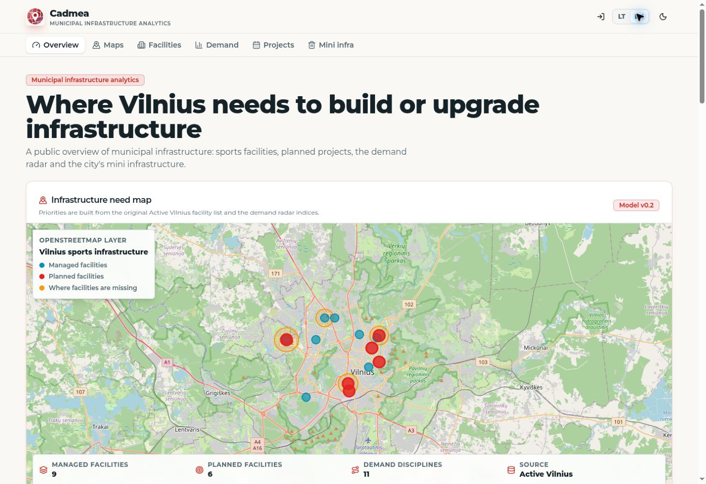
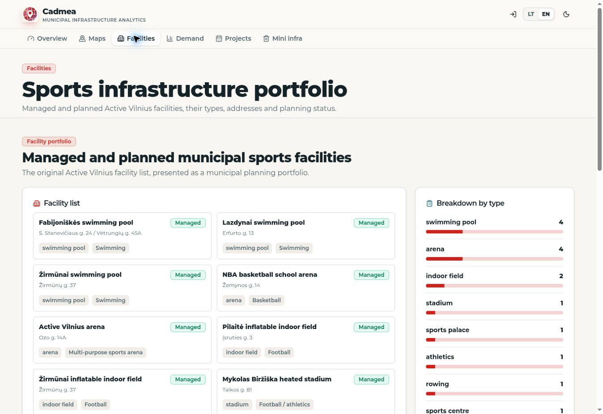
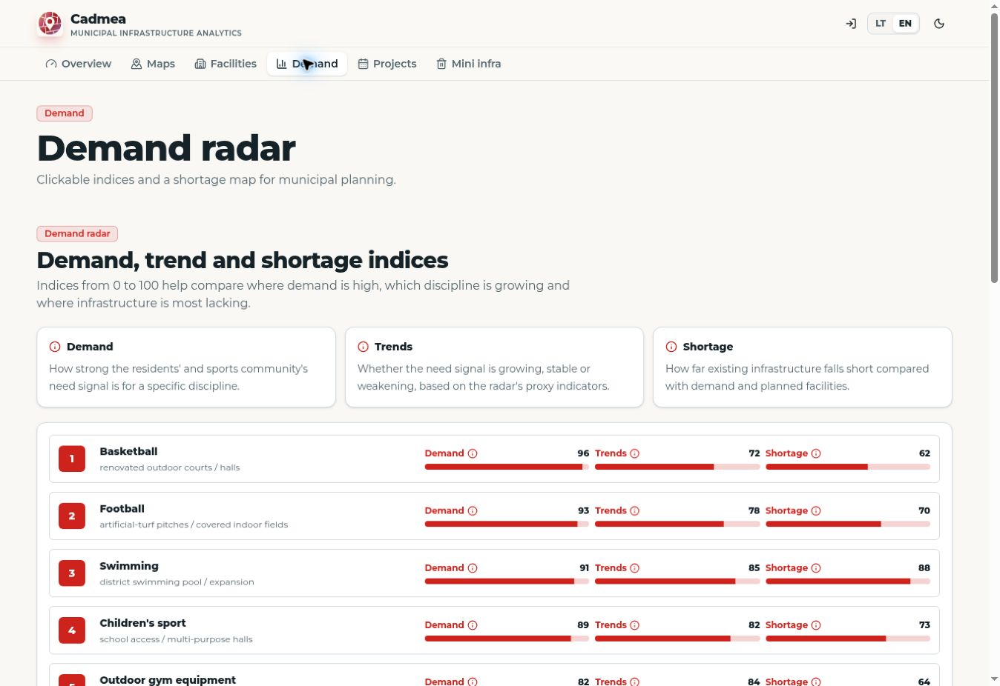
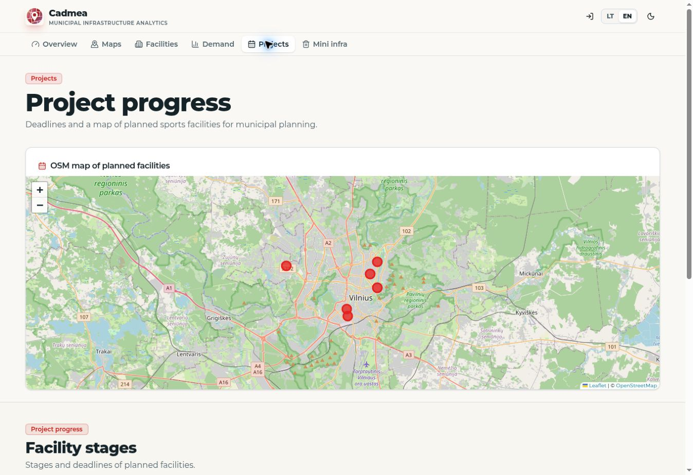
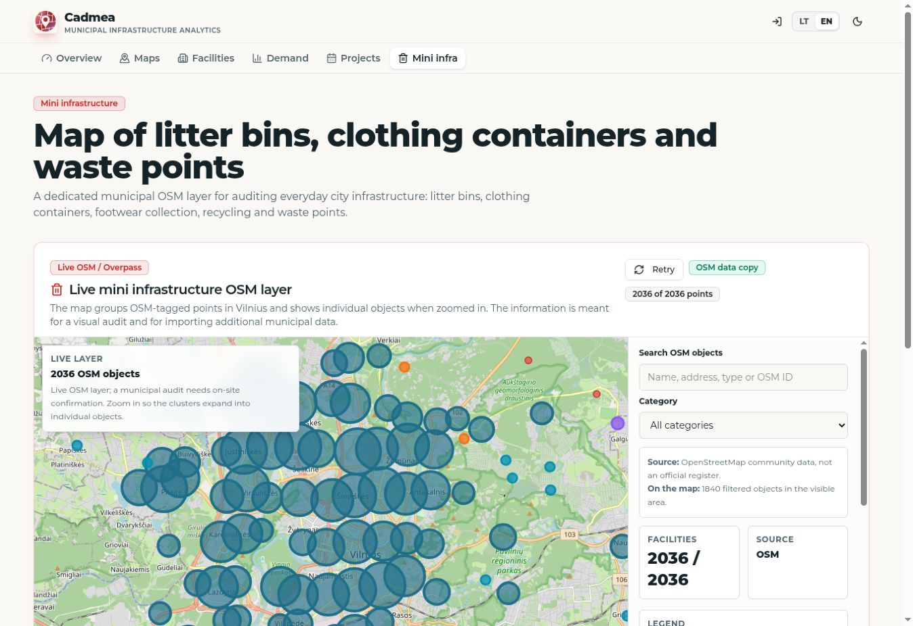
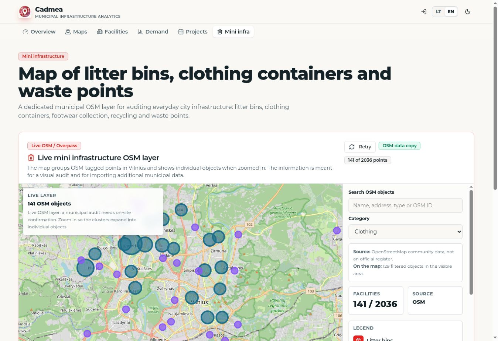

# CADMEA product walkthrough

Six direct screenshots from the working public application on **November 7, 2026**. These views were captured from the anonymous public application with its English language option selected. The interface is collaborative team work; Paulius's primary technical role was backend and algorithms.

[My backend and algorithm work](MY_BACKEND_AND_ALGORITHM_WORK.md) · [Overview](../README.md) · [Capture timestamps and image hashes](../assets/live-screenshots/2026-11-07/CAPTURE_INFO.json)

## Infrastructure overview

Open the application and select EN. The public overview combines managed facilities, planned facilities and demand indications. The captured version displays 9 managed facilities, 6 planned facilities and 11 demand disciplines; these are application records, not an independently audited city inventory.

## Facility portfolio

Select Facilities. The portfolio keeps each facility's type, address and planning status visible. The grouped breakdown provides context for the map without treating every object as interchangeable.

## Demand radar

Select Demand. Demand, trend and shortage indicators are displayed separately, with explanations. These planning indices include proxy information. A high displayed index alone does not establish verified unmet demand.

## Planned projects

Select Projects. The map and facility stages show the planned portfolio. Dates and stages are records displayed by the application and do not establish official approval or current construction status.

## OSM ingestion and fallback

Select Mini infra. The captured application labels its source OSM data copy and displays 2,036 cached OSM objects. This layer covers waste, recycling, litter bins and clothing collection, separate from the sports inventory. It illustrates the data retrieval and snapshot fallback described in the backend notes.

## Category filtering

On Mini infra, select Clothing in Category. The captured snapshot narrows from 2,036 records to 141 clothing collection points. The on map count is smaller because it depends on the visible bounds. This shows source category filtering, not the municipal candidate scoring model.

## Capture notes

The screenshots retain the browser capture bytes. No interface elements, values or map content were reconstructed. Each image's metadata records its exact URL, time, viewport and SHA256 hash. The November 2 captures remain available in the parent screenshot folder; the original archival team recording remains separate.
